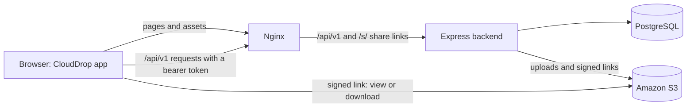
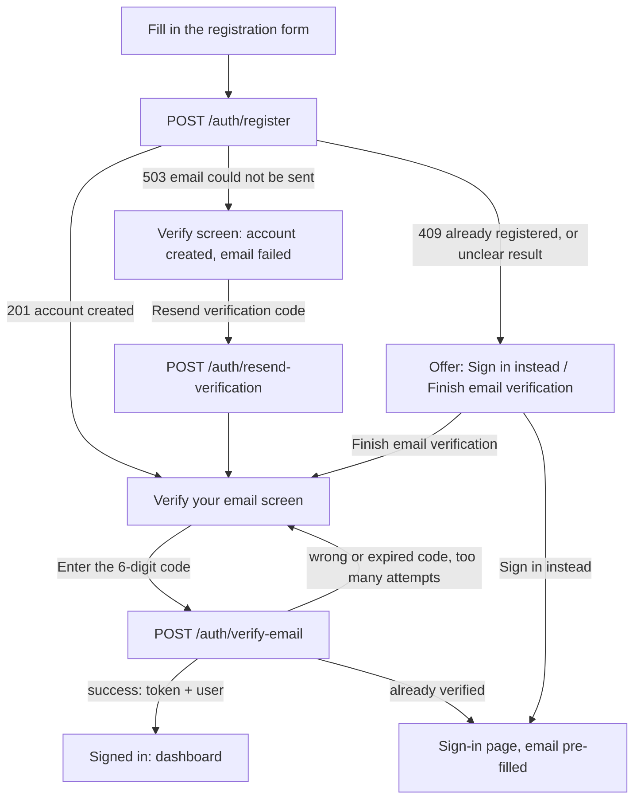
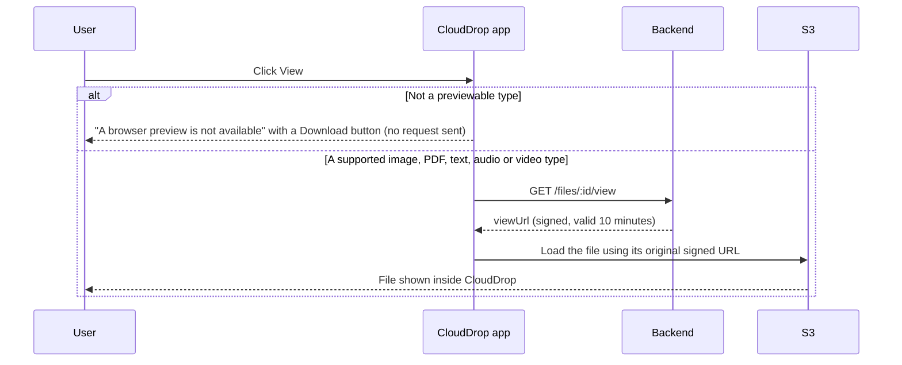

# How the CloudDrop frontend works

This document explains how the CloudDrop web app behaves from a user's point of view and what it does behind the scenes: which pages exist, how sign-in and sessions work, and what happens at each step of the account and file flows. It describes the code on `main`. For setup and test commands, see the [frontend README](../README.md).

## At a glance

- The frontend is a single-page React app (React 19, TypeScript, Vite). In production, Nginx serves the built files and forwards `/api/v1` requests to the Express backend on the same domain.
- The app never handles storage credentials. Files go to the backend on upload. For viewing, downloading and sharing, the backend returns short-lived signed links, and the browser fetches the file from S3 directly.
- The app has two modes. **Live mode** (`VITE_USE_MOCK_API=false`) talks to the real backend. **Demo mode** (`VITE_USE_MOCK_API=true`, the default for `npm run dev`) runs entirely in the browser with sample data and no backend. See [Demo mode](#demo-mode).

## Pages

| Address | Page | Who can open it |
| --- | --- | --- |
| `/login` | Sign in | Signed-out users. Signed-in users are sent to `/`. |
| `/register` | Create account, then verify email | Signed-out users. Signed-in users are sent to `/`. |
| `/forgot-password` | Request a password-reset email | Anyone |
| `/reset-password?token=…` | Choose a new password | Anyone with a reset link |
| `/` | Dashboard | Signed-in users |
| `/files` | File library | Signed-in users |
| `/files/:id` | File details | Signed-in users |
| `/upload` | Upload queue | Signed-in users |
| `/account` | Profile details and Delete account | Signed-in users |
| anything else | Not found | Anyone |

If a signed-out user opens a protected page, the app sends them to `/login` and returns them to that page after they sign in.

Public share links (`/s/<token>`) are handled by the backend, not by this app. See [Share](#share).

## Sessions

- Signing in, or finishing email verification, returns an access token (JWT). The app keeps it in the browser tab's `sessionStorage` under `clouddrop.access-token`. It lasts until the tab is closed or the user signs out.
- Every API request sends the token as `Authorization: Bearer <token>`.
- **When the app loads** with a saved token, it calls `GET /auth/me`:
  - Success: the user is signed in.
  - `401`: the token is cleared and the user signs in again.
  - Network or server error: the app shows "Unable to restore your session", with **Retry** and **Sign out** buttons.
- **If any later request returns `401`**, the app clears the token and returns to the sign-in page with "Your session has ended. Please sign in again."
- **Sign out** clears the token.

## Account flows

### Sign up and verify email

1. The user enters their first name, last name, email and a password of at least 8 characters. The app sends `POST /auth/register`.
2. The backend creates an **unverified** account and emails a 6-digit code. The app shows **Verify your email**. No session is created yet.
3. The user enters the code. The app sends `POST /auth/verify-email` with `{ email, code }`. The response includes a token, so the user is signed in and taken to the dashboard.

What happens when something goes wrong:

| Situation | Backend response | What the user sees |
| --- | --- | --- |
| The verification email failed to send | `503 VERIFICATION_EMAIL_FAILED` | The verify screen, saying the account was created. **Resend verification code** sends `POST /auth/resend-verification`. |
| The email is already registered, or the result is unclear (network error or 5xx) | `409 EMAIL_ALREADY_REGISTERED` | **Sign in instead** (email pre-filled) and **Finish email verification**. The app doesn't claim an account was created. |
| Wrong or expired code | `400 INVALID_VERIFICATION_CODE` | "That code is incorrect or has expired." Request a new code. |
| Too many wrong codes | `429 VERIFICATION_ATTEMPTS_EXCEEDED` | "Too many incorrect codes. Request a new verification code." |
| Already verified, for example in another tab | `409 EMAIL_ALREADY_VERIFIED` | "Email already verified", with a link to sign in. |

The resend confirmation is deliberately neutral ("If the account is eligible, a new verification email will be sent"), so it doesn't reveal which emails have accounts.

### Sign in

1. The user enters their email and password. The app sends `POST /auth/login`.
2. On success, the token is saved and the user goes to the dashboard, or back to the page they first asked for.

| Situation | Backend response | What the user sees |
| --- | --- | --- |
| Wrong email or password | `401 INVALID_CREDENTIALS` | "Incorrect email or password." |
| Email not verified yet | `403 EMAIL_NOT_VERIFIED` | The **Verify your email** screen, where they can enter a code or request a new one. Nothing is resent automatically. |

### Forgot and reset password

1. **Forgot password?** on the sign-in page opens `/forgot-password`. The user enters their email, and the app sends `POST /auth/forgot-password` with `{ email }`. The reply is always the same, "If an account exists for that email, password-reset instructions will be sent", so it doesn't reveal which emails are registered.
2. The email links to `/reset-password?token=…`. The user chooses a new password, and the app sends `POST /auth/reset-password` with `{ token, newPassword }`.
3. On success, the app removes the token from the address bar and shows "Password updated". The user then signs in with the new password.
4. If the link is invalid, expired or already used (`INVALID_OR_EXPIRED_RESET_TOKEN`), or the token is missing from the address, the page explains this and offers to request a new link.

### Delete account

1. **Account** in the sidebar opens `/account`, which shows the user's name and email and a **Delete account** section.
2. **Delete account** opens a confirmation dialog. It says what will be lost: either the number of files, from `GET /dashboard/stats`, or that there are no stored files. The final **Delete account** button stays disabled until the user types `DELETE`.
3. The app sends `DELETE /auth/me` with the bearer token. The backend deletes the user's files from S3, then the account. The database removes the user's file records and share links with it.
4. Only after a successful response does the app sign the user out: it clears the token and cached data, then shows "Your account and all of its files have been deleted." on the sign-in page.
5. If deletion fails, the user stays signed in, the dialog stays open with the reason, and they can try again. No success message is shown.

| Situation | Backend response | What the user sees |
| --- | --- | --- |
| Some files couldn't be removed from storage | `502 S3_CLEANUP_FAILED` | "Your account was not deleted because some files could not be removed…" |
| Files removed, but the account couldn't be deleted | `500 ACCOUNT_DELETE_FAILED` | "Your files were removed, but your account could not be deleted…" |
| The account no longer exists | `404 USER_NOT_FOUND` | "This account no longer exists. Sign out to continue." |
| The session has expired | `401` | The usual "Your session has ended" sign-out |

The button is disabled while uploads are running, so files can't be added during deletion.

## File flows

### Dashboard (`/`)

- `GET /dashboard/stats` gives the totals: number of files, storage used and categories in use.
- `GET /files?page=1&limit=5` gives the five most recent files.
- Each recent file has the same actions as the library: View, Download, Share and Delete.

### Upload (`/upload`)

1. The user drags files onto the page or picks them. Each file is checked in the browser first:
   - **Size:** 25 MB or less, the same limit as the backend.
   - **Type:** PDF, Word, Excel, PowerPoint, TXT, CSV, JPEG, PNG, GIF, WebP, MP4, MPEG, WebM, MP3, WAV, OGG, ZIP, RAR or 7z, the same list as the backend.

   Rejected files stay in the queue with the reason.
2. Each file gets a **category automatically** from its type: Documents, Images, Videos, Audio, Archives or Other. It is shown as a read-only label; users can't change it.
3. **Upload all** sends the files one at a time. Each is a `POST /files` multipart request with `file` and `category` fields, and shows a progress bar.
4. **Cancel** stops the upload in progress. A failed upload shows its error, and **Retry** is offered when the error is temporary, such as a network error, a server error or a cancellation.
5. Uploads keep running while the user moves between pages. When they finish, the file library and dashboard refresh.

### File library (`/files`) and details (`/files/:id`)

- The library loads 10 files per page with `GET /files?page=…&limit=10`. Search adds `search=…`, starting 300 ms after the user stops typing, and the category filter adds `category=…`. The server does the searching, filtering and paging, and the page shows the server's total count.
- Opening a file goes to `/files/:id`, which loads `GET /files/:id`. If the file no longer exists, the page says so. A server error is shown as an error, not as "file not found".

### View

- The preview types match the merged backend: **PDF; JPEG, PNG, GIF and WebP; plain text, CSV, Markdown, JSON, YAML and SQL; MP4, MPEG and WebM video; MP3, WAV and Ogg audio**. A PDF also needs the browser's built-in viewer. Audio/video use native controls without autoplay; codec support depends on the browser.
- Text is displayed as literal content, so HTML or scripts in a file are not executed. Only the first 1 MiB is read for large text files, with an explicit truncation notice. The request is cancelled when the dialog closes. Fetching text requires the storage CORS policy to allow GET from the frontend origin; bearer tokens and cookies are not sent to storage.
- For any other type, the dialog explains that a preview isn't available and offers Download, without contacting the backend.
- If the backend refuses (`415 PREVIEW_NOT_SUPPORTED`), the link expires, or loading fails, the dialog shows a message with retry and Download actions. View never navigates to a text URL that could unexpectedly start a download.

### Download

1. The user clicks **Download**. The app sends `GET /files/:id/download`.
2. The backend returns a signed S3 link, valid for 10 minutes, that tells the browser to save the file under its original name.
3. The app starts the download automatically. If the browser blocks that, a **Save file** button stays available.
4. Safety checks:
   - Links must use HTTPS.
   - The access token is never sent to S3.
   - If the backend returns a link that would open in the browser instead of saving, the app refuses to open it: "Direct download is not available for this file yet. You can use View to preview it."
5. The user can cancel while the link is being prepared, retry after an error, and get a fresh link once one expires.

### Share

1. The user clicks **Share** and chooses how long the link lasts: **1 hour**, **1 day** (the default) or **7 days**.
2. The app sends `POST /files/:id/share`, with `ttlHours` in the body for 1 hour or 7 days.
3. The dialog shows the link with its exact expiry date and time, and a **Copy** button.
4. Anyone with the link can download the file until it expires. They don't need an account.

When someone opens a share link (`/s/<token>`), the **backend** handles it, not the app:

- If the link is still valid, the backend redirects to a signed S3 download link that lasts at most 5 minutes.
- If the link is invalid or expired, it returns `404` "This share link is invalid or no longer available".
- Share links are limited to 30 requests per 15 minutes from each IP address.

### Delete

1. **Delete** opens a confirmation dialog.
2. On confirm, the app sends `DELETE /files/:id`, then refreshes the file library and dashboard.
3. The dialog can't be closed while the deletion is in progress. If it fails, the file stays and the user can try again.

## API endpoints used by the frontend

All paths are under `/api/v1`, except share links.

| Method | Path | Used for |
| --- | --- | --- |
| POST | `/auth/register` | Create an account |
| POST | `/auth/verify-email` | Confirm the 6-digit code and start a session |
| POST | `/auth/resend-verification` | Send a new verification code |
| POST | `/auth/login` | Sign in |
| GET | `/auth/me` | Restore a session when the app loads |
| DELETE | `/auth/me` | Delete the signed-in user's account and files |
| POST | `/auth/forgot-password` | Request a reset email |
| POST | `/auth/reset-password` | Set a new password |
| GET | `/dashboard/stats` | Dashboard totals |
| GET | `/files` | List, search, filter and page files |
| POST | `/files` | Upload one file |
| GET | `/files/:id` | File details |
| GET | `/files/:id/view` | Signed link for previewing |
| GET | `/files/:id/download` | Signed link for downloading |
| POST | `/files/:id/share` | Create a temporary share link |
| DELETE | `/files/:id` | Delete a file |
| GET | `/s/<token>` (no `/api/v1` prefix; opened by the recipient) | Public share link, handled entirely by the backend |

## How errors are shown

- The backend returns errors with a code, for example `{ "success": false, "message": "…", "error": { "code": "INVALID_CREDENTIALS" } }`. The app turns each known code into a plain-language message. The full list is in [`src/lib/messages.ts`](../src/lib/messages.ts).
- Raw server messages, tokens and storage keys are never shown to users.
- Network errors, server errors (5xx) and rate limits (429) are treated as temporary, so the user is offered a retry. Unknown errors show a general "Something went wrong" message.
- Every page has designed loading, empty and error states. Form errors are attached to the field they belong to, and the first invalid field gets focus.

## Demo mode

With `VITE_USE_MOCK_API=true`, the default when running `npm run dev`, the app uses an in-browser copy of the API:

- Any email and a password of 8 or more characters can sign in. `demo@clouddrop.app` starts with sample files; other accounts start empty.
- The verification code is `123456`, and the forgot-password page links to a working demo reset form.
- No email is sent, nothing reaches a server, and refreshing the page resets everything.

Demo mode is for development, design reviews and automated UI tests. It doesn't test the real backend, S3 or Nginx.

## Where things live in the code

| Area | Location |
| --- | --- |
| Routes and page protection | `src/app/App.tsx` |
| Pages | `src/pages/` |
| Sign-in, sessions, verification and password reset | `src/features/auth/`, `src/pages/AuthPage.tsx`, `src/pages/PasswordRecoveryPage.tsx` |
| Account page and Delete account | `src/pages/AccountPage.tsx`, `src/features/auth/AuthProvider.tsx` |
| API client (token header, 401 handling) | `src/features/files/api/api-client.ts`, `src/lib/api.ts`, `src/lib/runtime.ts` |
| File API calls and response checks | `src/features/files/api/` (`files-http-repository.ts` for live mode, `files-mock-repository.ts` for demo mode) |
| View, Download, Share and Delete dialogs | `src/features/files/hooks/useFileActions.tsx` |
| Preview rules | `src/features/files/lib/file-preview.ts`, `src/features/files/components/FilePreview.tsx` |
| Upload queue, limits and categories | `src/features/upload/` |
| User-facing error messages | `src/lib/messages.ts` |

## Related documents

- [Frontend README](../README.md): running, configuring and testing the app.
- [Verification recovery](auth-verification-recovery.md) and [live email verification](live-email-verification.md): sign-up email handling and tests.
- [Password recovery handoff](password-recovery-handoff.md): reset API contract and rollout checks.
- [Final QA report](final-qa-report.md) and [QA checks](final-qa-checks.csv): live test results and evidence.
- [Accessibility review](accessibility-review.md): automated checks and the remaining manual screen-reader pass.
- Backend handoffs: [downloads](backend-download-handoff.md), [categories](backend-category-handoff.md) and [short links](backend-short-links-handoff.md).
